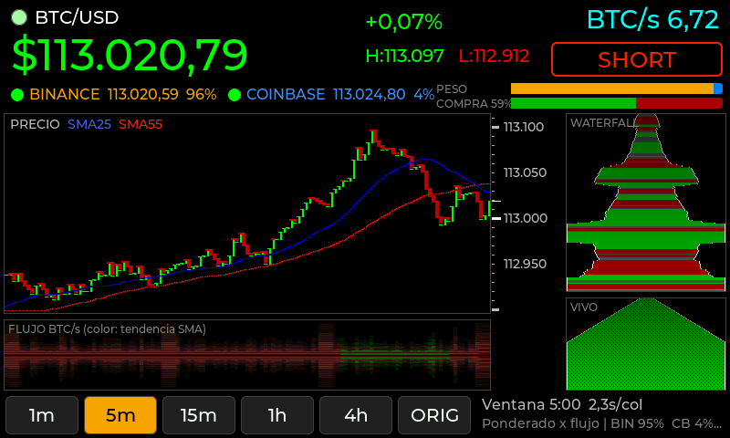

# PRRR BITCOIN — Waveshare ESP32-S3-Touch-LCD-7 (800×480)

Port del monitor PRRR (ESP32 + ST7789 172×320) a la **Waveshare ESP32-S3-Touch-LCD-7**
(ST7262 RGB, táctil GT911, 8 MB PSRAM) usando **LVGL 8.3.11**, **ESP32_Display_Panel** y el
adaptador **`esp_lv_adapter_arduino`** de la demo `09_lvgl_v8_demo` probada en la placa.

La carpeta es autosuficiente: trae el adaptador y `esp_panel_board_custom_conf.h` de esa demo.
Solo hay que configurar el WiFi (ver "Instalación").

Se conservaron los cálculos, los WebSockets y la estética del original: precio ponderado por
flujo, buckets lógicos, SMA 25/55, LONG/SHORT, BTC/s, río de flujo con dithering, waterfall
en perspectiva, escala de ticks y actualización parcial. El sketch original quedó como
referencia en `original/PRRR_ST7789_original/` (sin las claves WiFi).



## Qué está verificado y qué no

| Estado | Qué | Cómo |
|---|---|---|
| **Compilado** | La carpeta completa, con el adaptador y la configuración de la demo, compila sin errores para ESP32 core **3.3.12**, placa *Waveshare ESP32-S3-Touch-LCD-7*, PSRAM Enabled, Flash 8 MB, Huge APP, CPU 240 MHz. Usa 50 % de flash y 17 % de RAM interna | `arduino-cli` con ESP32_Display_Panel 1.0.5, ESP32_IO_Expander 1.1.1, esp-lib-utils 0.3.0, lvgl 8.3.11, WebSockets 2.7.3, ArduinoJson 7.4.2 |
| **Compilado** | El firmware toma `esp_panel_board_custom_conf.h` de esta carpeta | El binario contiene `Waveshare:ESP32-S3-Touch-LCD-7` y el driver ST7262 |
| **Simulado** | Cálculos, dibujo, interfaz LVGL, toque en los botones y cambio de ventana, con LVGL en modo `full_refresh` y doble buffer como el adaptador. ~8 cuadros completos por segundo | Los mismos `.cpp` compilados en una PC con LVGL 8.3.11 real y trades sintéticos. Las capturas de `docs/` salen de ahí |
| **Pendiente en la placa** | FPS y carga de CPU reales, ancho de banda de la PSRAM con la pantalla completa redibujándose, espera del lock durante el VSYNC, táctil GT911 real y WebSockets reales desde este sketch | Ver "Primer arranque" |

## Arquitectura

```
 Tarea LVGL (esp_lv_adapter, prioridad 2)    Tarea loop() (Arduino, prioridad 1)
 ───────────────────────────────────────     ─────────────────────────────────────────
 lv_timer_handler(): refresco + táctil        feedsLoop(): WiFi + wsBinance/wsCoinbase.loop()
        │                                         └─ callbacks → market.cpp (solo datos)
        │ botón tocado → atomic<int>              updateFlows(), updateVirtualLed()
        │ requestedWindow ───────────────────▶   marketApplyWindow() si hay pedido
        │                                         render.cpp → Canvas565 (buffer TRASERO, PSRAM)
        │                                         publishFrame():
        │◀── esp_lv_adapter_lock(60 ms) ──────      copia rects sucios → buffer del lv_canvas
        │     (máx. 1 vez cada 120 ms)               uiApply(textos ya formateados)
        │                                          esp_lv_adapter_unlock()
```

- **Ningún callback WebSocket llama a LVGL.** Los callbacks solo actualizan el modelo, igual
  que en el original.
- El dibujo por píxeles (lento) se hace **fuera** del lock, en un buffer privado. Bajo el lock
  solo se copian las zonas modificadas y se asignan los textos ya armados. Así LVGL nunca
  muestra un cuadro a medio dibujar y la red no queda bloqueada esperando a la pantalla.
- Si el lock está ocupado (`esp_lv_adapter_lock(60)` falla), las zonas sucias se conservan y
  se publican en la vuelta siguiente.

### Qué cambió al usar el adaptador de la demo

El adaptador usa los **dos framebuffers del panel RGB como buffers de LVGL** (`full_refresh`).
Eso tiene dos consecuencias para el PRRR:

1. **Cualquier invalidación redibuja las 800×480 líneas completas.** Antes, el río, la cola
   del gráfico y los textos se publicaban cada uno a su ritmo, y eso habría provocado 10–25
   redibujados completos por segundo. Ahora `publishFrame()` junta todo y publica **como
   máximo una vez cada 120 ms** (`publishIntervalMs`). La actualización parcial sigue
   ahorrando trabajo donde importa: el PRRR solo vuelve a dibujar las zonas que cambiaron y
   solo copia esos rectángulos al lienzo de LVGL.
2. **La tarea LVGL retiene el lock mientras espera el VSYNC** (`flush_cb` →
   `ulTaskNotifyTake`). Por eso el timeout del lock subió de 20 a 60 ms
   (`publishLockTimeoutMs`). Si no alcanza, no se pierde nada: se reintenta en la vuelta
   siguiente.

`canvas.publish()` sigue siendo correcto con este modo: escribe en el buffer del `lv_canvas`
siempre con el lock tomado, así que LVGL nunca lo lee a medio copiar. `lv_obj_invalidate_area()`
recibe coordenadas absolutas de pantalla y dispara el redibujado.

El orden de `setup()` es el de la demo: `Board::init` → framebuffers y bounce buffer →
`Board::begin` → `esp_lv_adapter_init` → `register_display` → `register_touch` →
`esp_lv_adapter_start` → creación de la interfaz con el lock tomado. El `lvgl_v8_port` de la
versión anterior se eliminó: no hay dos implementaciones mezcladas.
- Serial: solo eventos de conexión y un resumen cada 10 s. Nunca se imprime cada trade.

### Archivos

| Archivo | Contenido |
|---|---|
| `PRRR_Waveshare7.ino` | `setup()` (misma secuencia que 09_lvgl_v8_demo), `loop()`, formato de textos y `publishFrame()` |
| `esp_lv_adapter_arduino.h/.cpp` | Adaptador LVGL de la demo, **sin modificar**: tarea LVGL, tick, lock, display RGB y táctil |
| `esp_panel_board_custom_conf.h` | Configuración de la placa de la demo, **sin modificar**: pines RGB, GT911, CH422G y backlight |
| `prrr_config.h` | Colores, tiempos, geometría 800×480, ventanas y activación por etapas |
| `market.h/.cpp` | Modelo original: exchanges, precio ponderado, buckets, SMA, flujo, LED virtual |
| `feeds.h/.cpp` | WiFi multi-red y WebSockets Binance/Coinbase (mismos endpoints) |
| `render.h/.cpp` | Funciones de dibujo originales (precio, SMA, ticks, río y waterfall) |
| `canvas565.h/.cpp` | Reemplazo de Arduino_GFX: primitivas RGB565 con doble buffer y rectángulos sucios |
| `color565.h` | `lerp565`, `scale565` |
| `ui.h/.cpp` | Objetos LVGL: precio, BTC/s, LONG/SHORT, exchanges, barras, escala y botones |
| `wifi_secrets.example.h` | Plantilla de credenciales (copiar a `wifi_secrets.h`, que no se sube) |

## Qué se reutilizó y qué se adaptó

| Parte del original | En el port |
|---|---|
| `recomputeWeightedPrice`, `updateFlows`, `isFresh`, stale 15 s | Igual. Precios en `double` |
| Buckets lógicos (`ingestChartSample`, `writeBucketSample`, `rebuildVisibleHistory`) | Igual. El id de bucket avanza solo cuando llega un trade |
| `calcSMAAt`, `updateCrossSignal`, `trendBullRatioAt` | Igual. Sumas en `double` |
| `computeChartRange` (+8 % de margen), `chartRangeChanged` | Igual |
| Dibujo de precio en escalones, SMA de doble trazo, ticks $10/$100/$1000 | Igual, sobre `Canvas565` |
| `drawFlowBand`, `drawFlowWaterfall`, `drawLiveFlowFront` | Igual. En el original existían pero **no se llamaban**; ahora tienen paneles propios |
| Texto con `gfx->print` | Etiquetas LVGL (Montserrat) |
| NeoPixel (`updateLed`) | "LED virtual": círculo junto a BTC/USD, misma fórmula y suavizado |
| Badge L/S dentro del gráfico | Recuadro LONG/SHORT grande en la cabecera |
| `Arduino_GFX`, ST7789, pines SPI, `BL_PIN`, `LED_PIN`, `setCpuFrequencyMhz(80)` | Eliminados. ESP32_Display_Panel gestiona RGB, táctil y backlight (por CH422G). La CPU queda a 240 MHz porque el bus RGB lo necesita |

### Cambios de cálculo y por qué

1. **`double` para precios y SMA.** Un `float` tiene 24 bits de mantisa: a ~112.000 USD el
   paso mínimo es ~0,008 USD y la suma de 55 precios (~6·10⁶) redondea a 0,5 USD. Las
   fórmulas no cambian. El S3 calcula `double` por software, pero son pocos miles de
   operaciones por cuadro.
2. **`updateFlows()` ya no hace `chartDirty = false`.** En el original esa línea podía
   cancelar un redibujado completo pendiente (avance de bucket o cambio de escala) si coincidía
   en la misma vuelta de `loop()`. El gráfico quedaba sin desplazarse hasta el siguiente
   cambio de rango.
3. **`drawTailRegion()` corregida.** Con columnas de 4 px, `xStart = prevX + 8` quedaba a la
   derecha de `xEnd` y la función salía sin dibujar. La última columna solo se actualizaba en
   redibujados completos. Ahora se limpia y redibuja exactamente esa columna cada 120 ms.
4. **El río de flujo no se recalcula en cada trade.** `flowHistory` depende del reloj y de
   `flowSecondBuckets`, que solo cambian en `updateFlows()`. Antes eran hasta 14.400
   iteraciones por trade; ahora se hace cada 120 ms con el mismo resultado.
5. **Río alineado durante el arranque.** El original hacía `oldestSecond = 0` mientras el
   uptime era menor que la ventana, así que el río crecía desde la izquierda y no coincidía
   con el precio, que crece desde la derecha. Ahora los segundos negativos quedan vacíos.
6. **`waterfallRoadColorForTrend`** comparaba `ri < histCount` y promediaba columnas vacías
   (precio 0) con el historial incompleto. Ahora usa solo columnas válidas.
7. **H:/L: muestran el máximo y el mínimo reales** de la ventana. El original mostraba los
   bordes del gráfico, que incluyen el 8 % de margen.
8. **Ventanas táctiles.** En el original eran constantes. Al cambiar de ventana, los buckets
   se reconstruyen desde un historial de precio por segundo (5,6 h en PSRAM), así no se pierde
   lo recibido. Las columnas reconstruidas usan tiempo de reloj: un hueco sin trades queda
   vacío en vez de comprimirse. Desde ahí sigue la lógica original.

**Nota sobre la ventana original:** `CHART_WINDOW_MS = CHART_WINDOW_SECONDS * 120UL` daba
1.728.000 ms (**28:48**) para el precio, mientras el río usaba `CHART_WINDOW_SECONDS` =
**4 h**. No sé si era intencional, así que el botón **ORIG** reproduce exactamente eso y es
la ventana inicial. Los demás botones (1m, 5m, 15m, 1h, 4h) usan la misma ventana para precio
y flujo.

### Agregado nuevo (no estaba en el original)

- **Barra AGRESOR / COMPRA %:** volumen de Binance separado por lado agresor según el campo
  `m` del stream `@trade` (`m = true`: el comprador es maker, así que el agresor vendió).
  Usa el mismo suavizado EMA (α = 0,35) que el flujo. Coinbase no participa porque no verifiqué
  el significado exacto de `side` en su canal `ticker`.
- **Etiquetas de escala** con valores redondos a la derecha de los ticks originales.
- **Barra PESO:** participación de Binance (naranja) y Coinbase (azul) en la ponderación.

## Instalación (Arduino IDE)

### 1. Bibliotecas

Las que ya tenés: **ESP32_Display_Panel** (con sus dependencias **ESP32_IO_Expander** y
**esp-lib-utils**), **lvgl 8.3.11**, **WebSockets** (Markus Sattler, `WebSocketsClient`) y
**ArduinoJson 7.x**. No hacen falta Arduino_GFX ni Adafruit_NeoPixel.

### 2. `lv_conf.h`

Usá el mismo `lv_conf.h` con el que compila la demo `09_lvgl_v8_demo`, en el mismo lugar
(normalmente `Documentos/Arduino/libraries/lv_conf.h`). No hace falta tocarlo, pero conviene
revisar:

| Opción | Valor |
|---|---|
| `LV_COLOR_DEPTH` | `16` (si no, el sketch da error de compilación a propósito) |
| `LV_COLOR_16_SWAP` | `0` para RGB |
| `LV_USE_CANVAS` | `1` (viene así por defecto) |
| `LV_FONT_MONTSERRAT_12/14/16/20/24/28/48` | `1`. Si falta alguna, se usa una más chica y compila igual |
| `LV_USE_PERF_MONITOR` | Recomendado `0`: si está en 1, el contador de FPS tapa la línea de estado. Útil activarlo un rato para medir |

### 3. WiFi

En el ZIP ya viene un **`wifi_secrets.h`** con datos de ejemplo: abrilo (es una pestaña del
IDE) y poné tus redes. Se prueban en orden, igual que en el original. En el repositorio ese
archivo está en `.gitignore`. Si lo bajás desde GitHub, copiá `wifi_secrets.example.h` como
`wifi_secrets.h`.

### 4. Nada más que copiar

El adaptador `esp_lv_adapter_arduino` y `esp_panel_board_custom_conf.h` ya están en la
carpeta. No uses `esp_panel_board_supported_conf.h` ni `lvgl_v8_port.*` en esta carpeta.

### 5. Menú Herramientas

| Opción | Valor |
|---|---|
| Placa | **Waveshare ESP32-S3-Touch-LCD-7** (en el core 3.3.12 su "PSRAM: Enabled" es OPI) |
| CPU Frequency | 240 MHz |
| Flash Size | 8MB (64Mb) |
| Partition Scheme | Huge APP (3MB No OTA/1MB SPIFFS) |
| PSRAM | Enabled |
| USB CDC On Boot | Como en la demo que te funcionó |
| Puerto | COM14 |

Si usás *ESP32S3 Dev Module*, elegí **PSRAM: OPI PSRAM**. Ahí "Enabled" significa QSPI y
no sirve para esta placa.

### 6. Compilar y cargar

Abrí `PRRR_Waveshare7/PRRR_Waveshare7.ino` → Verificar → Subir. Monitor serie a 115200.

## Primer arranque y verificación por etapas

En `prrr_config.h`:

```cpp
#define PRRR_ENABLE_SMA        1
#define PRRR_ENABLE_FLOW_BAND  1
#define PRRR_ENABLE_WATERFALL  1
```

Para ir paso a paso, poné los tres en `0` (solo precio en vivo y gráfico) y activalos de a uno.

Salida esperada por Serial:

```
[PRRR] 1 - Board init
[PRRR] 2 - Board begin
[PRRR] 3 - LVGL init
[PRRR] 4 - LVGL start
[PRRR] 5 - Interfaz creada
[WiFi] Conectado a MiRed, IP: 192.168.1.191
[BIN] Conectado a: /ws/btcusdt@trade
[CB] Conectado a: /
[PRRR] precio=112345.67 BIN=on 112345.60 (18.0 msg/s) CB=on 112347.10 (4.2 msg/s) flujo=1.234 BTC/s cols=37 senal=1 heap=... psram=...
```

- **Etapa 1:** precio grande cambiando de color y puntos BIN/CB en verde. Con la ventana ORIG
  aparece una columna nueva cada ~13 s; con **1m**, cada 0,45 s.
- **Etapa 2:** las SMA aparecen cuando hay 25 y 55 columnas (con 1m, ~11 s y ~25 s). Después
  se muestra LONG/SHORT.
- **Etapa 3–4:** el río y el waterfall se mueven cada 240 ms.
- `heap`/`psram` del resumen tienen que mantenerse estables.

Colores de los puntos de exchange: verde = conectado y con datos frescos; amarillo =
conectado pero sin precio hace más de 15 s; rojo = desconectado.

### Si algo no anda

| Síntoma | Qué revisar |
|---|---|
| `Falta wifi_secrets.h` | Paso 3 |
| `PRRR requiere LV_COLOR_DEPTH 16` | Paso 2 |
| El Serial se queda en `[PRRR] 1`…`5` | Muestra en qué paso de la inicialización de pantalla se detuvo, con la misma numeración que la demo |
| `PSRAM no detectada` | Herramientas → PSRAM |
| Imagen que se corre, parpadea o va lenta | Ancho de banda de la PSRAM con redibujado completo. Subí `publishIntervalMs` (120 → 200) y `flowDrawIntervalMs` (240 → 400), o desactivá el waterfall para confirmarlo |
| El precio deja de actualizarse mientras se mueve la pantalla | La tarea LVGL (prioridad 2) le quita CPU a `loop()`. Subí `publishIntervalMs` |
| Colores invertidos (rojo↔azul o raros) | `LV_COLOR_16_SWAP` debe ser 0 |
| El táctil no cambia la ventana | Probá primero el táctil con la demo. El Serial imprime `[PRRR] Ventana -> 5m` al tocar |

## Ajustes rápidos

- `FLOW_BAR_MAX_BTCS` (2,0): escala del río y del waterfall. Subilo si se saturan.
- `COLOR_SMA_FAST`: sigue siendo el azul puro de prueba del original. Los verdes alternativos
  están en el comentario.
- `WINDOW_PRESETS`: agregá o cambiá ventanas (máximo 4 h de flujo por `FLOW_SECONDS_SLOTS`).
- `CHART_COLUMN_W` (4) y `CHART_INNER_W` (532): 133 columnas visibles.
- No hay trading ni órdenes: solo visualización.
