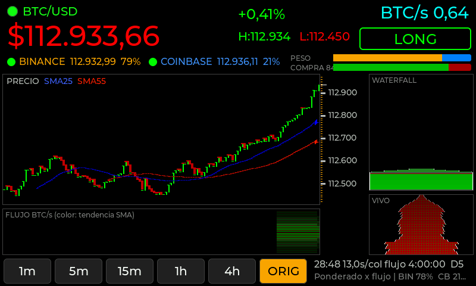
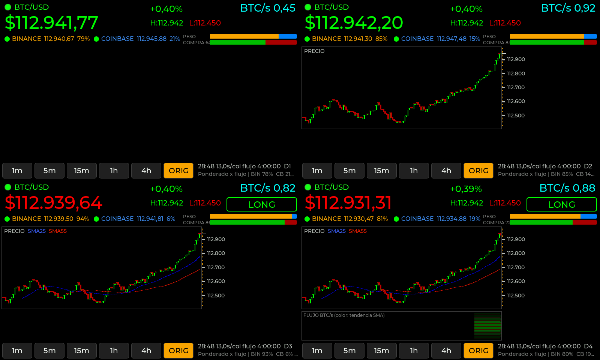

# PRRR BITCOIN — Waveshare ESP32-S3-Touch-LCD-7 (800×480)

Port del monitor PRRR (ESP32 + ST7789 172×320) a la **Waveshare ESP32-S3-Touch-LCD-7**
(ST7262 RGB, táctil GT911, 8 MB PSRAM) usando **LVGL 8.3.11**, **ESP32_Display_Panel** y el
adaptador **`esp_lv_adapter_arduino`** de la demo `09_lvgl_v8_demo` probada en la placa.

La carpeta es autosuficiente: trae el adaptador y `esp_panel_board_custom_conf.h` de esa demo.
Solo hay que configurar el WiFi (ver "Instalación").

Se conservaron los cálculos, los WebSockets y la estética del original: precio ponderado por
flujo, buckets lógicos, SMA 25/55, LONG/SHORT, BTC/s, río de flujo con dithering, waterfall
en perspectiva, escala de ticks y actualización parcial. El sketch original quedó como
referencia en `original/PRRR_ST7789_original/` (sin las claves WiFi).



## Qué está verificado y qué no

| Estado | Qué | Cómo |
|---|---|---|
| **Compilado** | La carpeta completa, con el adaptador y la configuración de la demo, compila sin errores para ESP32 core **3.3.12**, placa *Waveshare ESP32-S3-Touch-LCD-7*, PSRAM Enabled, Flash 8 MB, Huge APP, CPU 240 MHz. Usa 50 % de flash y 17 % de RAM interna | `arduino-cli` con ESP32_Display_Panel 1.0.5, ESP32_IO_Expander 1.1.1, esp-lib-utils 0.3.0, lvgl 8.3.11, WebSockets 2.7.3, ArduinoJson 7.4.2 |
| **Compilado** | El firmware toma `esp_panel_board_custom_conf.h` de esta carpeta | El binario contiene `Waveshare:ESP32-S3-Touch-LCD-7` y el driver ST7262 |
| **Simulado** | Cálculos, dibujo, interfaz LVGL, toque, cambio de ventana y los 5 niveles de diagnóstico, con dos framebuffers como el panel. En 9.376 cuadros nunca se dibujó sobre el buffer visible, y la imagen en modo direct es **idéntica píxel a píxel** a la de full_refresh en los 6 casos comparados. Direct redibuja ~136.000 px por cuadro en lugar de 384.000 | Los mismos `.cpp` compilados en una PC con LVGL 8.3.11 real y trades sintéticos. Las capturas de `docs/` salen de ahí |
| **Visto en la placa (versión anterior)** | Arranca, conecta y dibuja, pero con artefactos (texto punteado, rayitas) | Ver "Artefactos visuales" |
| **Pendiente en la placa** | Si el modo direct elimina los artefactos; FPS y tiempos reales del resumen `[RENDER]` | Ver "Diagnóstico en la placa" |

## Arquitectura

```
 Tarea LVGL (esp_lv_adapter, prioridad 2)    Tarea loop() (Arduino, prioridad 1)
 ───────────────────────────────────────     ─────────────────────────────────────────
 lv_timer_handler(): refresco + táctil        feedsLoop(): WiFi + wsBinance/wsCoinbase.loop()
        │                                         └─ callbacks → market.cpp (solo datos)
        │ botón tocado → atomic<int>              updateFlows(), updateVirtualLed()
        │ requestedWindow ───────────────────▶   marketApplyWindow() si hay pedido
        │                                         render.cpp → Canvas565 (buffer TRASERO, PSRAM)
        │                                         publishFrame():
        │◀── esp_lv_adapter_lock(60 ms) ──────      copia rects sucios → buffer del lv_canvas
        │     (máx. 1 vez cada 200 ms)               uiApply(textos ya formateados)
        │                                          esp_lv_adapter_unlock()
```

- **Ningún callback WebSocket llama a LVGL.** Los callbacks solo actualizan el modelo, igual
  que en el original.
- El dibujo por píxeles (lento) se hace **fuera** del lock, en un buffer privado. Bajo el lock
  solo se copian las zonas modificadas y se asignan los textos ya armados. Así LVGL nunca
  muestra un cuadro a medio dibujar y la red no queda bloqueada esperando a la pantalla.
- Si el lock está ocupado (`esp_lv_adapter_lock(60)` falla), las zonas sucias se conservan y
  se publican en la vuelta siguiente.

- Serial: solo eventos de conexión, el resumen `[PRRR]`/`[RENDER]` cada 10 s y los
  comandos de diagnóstico. Nunca se imprime cada trade.

### Garantía: nunca se dibuja sobre lo que se está mostrando

Hay tres buffers en juego, y cada uno tiene un solo escritor:

| Buffer | Quién escribe | Quién lee | Protección |
|---|---|---|---|
| Buffer trasero de `Canvas565` (PSRAM) | `loop()` (dibujo del PRRR) | `canvas.publish()` en `loop()` | Misma tarea: no hay concurrencia |
| Buffer del `lv_canvas` (`frontBuffer`) | `canvas.publish()`, solo con `esp_lv_adapter_lock()` | LVGL dentro de `lv_timer_handler()`, también con el lock | Mutex del adaptador |
| Framebuffers del panel (2, PSRAM) | Solo LVGL, siempre en el **oculto** | El panel RGB (bounce buffer) | `flush_cb` presenta el buffer recién dibujado y espera `on_frame_buf_complete` de esp_lcd antes de que LVGL vuelva a dibujar en el otro |

Revisé el código de esp_lcd de ESP-IDF 5.5 (el del core 3.3.12): `on_frame_buf_complete`
se dispara en el instante en que el panel deja de leer el framebuffer anterior. La espera del
adaptador es correcta. Además, el adaptador ahora **cuenta** cada cuadro dibujado sobre el
buffer visible (`sobreVisible` en el resumen `[RENDER]`). Tiene que ser siempre 0.

### Artefactos visuales: causa probable y corrección

Con el modo original del adaptador (`full_refresh`), **cada** cambio, aunque sea un número,
obliga a LVGL a redibujar las 800×480 líneas en la PSRAM. El PRRR cambia algo cada 120 ms:
eran ~8 redibujados completos por segundo (~1,5–2 MB de escrituras por cuadro). Mientras
tanto, el panel RGB necesita leer ~32 MB/s de esa misma PSRAM para refrescarse. Si la copia
hacia el bounce buffer llega tarde, el panel vuelve a mostrar un trozo viejo del bounce
buffer, es decir, píxeles de unas líneas más arriba. Eso produce texto punteado y rayitas que
"siguen al contenido", porque son copias de contenido cercano. La demo de LVGL casi no se
redibuja, por eso no mostraba el problema.

Cambios de esta versión:

1. **Modo `direct` (por defecto).** LVGL dibuja solo las zonas que cambiaron en el framebuffer
   oculto, y al cuadro siguiente copia esas mismas zonas al otro buffer
   (`refr_sync_areas` de LVGL 8.3). Es el modo 3 "direct" del `lvgl_v8_port` de Espressif:
   mismo `flush_cb` (presentar en el último flush y esperar), sin la copia de pantalla
   completa. En la simulación baja de 384.000 a ~136.000 px por cuadro, con imagen idéntica.
2. **Publicación cada 200 ms** en vez de 120 ms (`PRRR_PUBLISH_INTERVAL_MS`).
3. **Bounce buffer configurable** (`PRRR_BOUNCE_BUFFER_LINES`, 10 como la demo). Si con
   direct todavía aparecen artefactos, probá 20: le da al panel el doble de margen.
4. **Modo `full_refresh` disponible** (`d`/`f` por serie) para comparar en la placa.

Cambios en el adaptador (`esp_lv_adapter_arduino.*`, marcados `PRRR:`): campo
`profile.direct_mode`, `esp_lv_adapter_set_rgb_direct_mode()` y `esp_lv_adapter_get_stats()`.
Sin `direct_mode` se comporta exactamente como el de la demo.

El orden de `setup()` es el de la demo: `Board::init` → framebuffers y bounce buffer →
`Board::begin` → `esp_lv_adapter_init` → `register_display` → `register_touch` →
`esp_lv_adapter_start` → creación de la interfaz con el lock tomado.

### Archivos

| Archivo | Contenido |
|---|---|
| `PRRR_Waveshare7.ino` | `setup()` (misma secuencia que 09_lvgl_v8_demo), `loop()`, formato de textos y `publishFrame()` |
| `esp_lv_adapter_arduino.h/.cpp` | Adaptador LVGL de la demo (tarea LVGL, tick, lock, display RGB y táctil) con modo direct y estadísticas agregados, marcados `PRRR:` |
| `esp_panel_board_custom_conf.h` | Configuración de la placa de la demo, **sin modificar**: pines RGB, GT911, CH422G y backlight |
| `prrr_config.h` | Colores, tiempos, geometría 800×480, ventanas y activación por etapas |
| `market.h/.cpp` | Modelo original: exchanges, precio ponderado, buckets, SMA, flujo, LED virtual |
| `feeds.h/.cpp` | WiFi multi-red y WebSockets Binance/Coinbase (mismos endpoints) |
| `render.h/.cpp` | Funciones de dibujo originales (precio, SMA, ticks, río y waterfall) |
| `canvas565.h/.cpp` | Reemplazo de Arduino_GFX: primitivas RGB565 con doble buffer y rectángulos sucios |
| `color565.h` | `lerp565`, `scale565` |
| `ui.h/.cpp` | Objetos LVGL: precio, BTC/s, LONG/SHORT, exchanges, barras, escala y botones |
| `wifi_secrets.example.h` | Plantilla de credenciales (copiar a `wifi_secrets.h`, que no se sube) |

## Qué se reutilizó y qué se adaptó

| Parte del original | En el port |
|---|---|
| `recomputeWeightedPrice`, `updateFlows`, `isFresh`, stale 15 s | Igual. Precios en `double` |
| Buckets lógicos (`ingestChartSample`, `writeBucketSample`, `rebuildVisibleHistory`) | Igual. El id de bucket avanza solo cuando llega un trade |
| `calcSMAAt`, `updateCrossSignal`, `trendBullRatioAt` | Igual. Sumas en `double` |
| `computeChartRange` (+8 % de margen), `chartRangeChanged` | Igual |
| Dibujo de precio en escalones, SMA de doble trazo, ticks $10/$100/$1000 | Igual, sobre `Canvas565` |
| `drawFlowBand`, `drawFlowWaterfall`, `drawLiveFlowFront` | Igual. En el original existían pero **no se llamaban**; ahora tienen paneles propios |
| Texto con `gfx->print` | Etiquetas LVGL (Montserrat) |
| NeoPixel (`updateLed`) | "LED virtual": círculo junto a BTC/USD, misma fórmula y suavizado |
| Badge L/S dentro del gráfico | Recuadro LONG/SHORT grande en la cabecera |
| `Arduino_GFX`, ST7789, pines SPI, `BL_PIN`, `LED_PIN`, `setCpuFrequencyMhz(80)` | Eliminados. ESP32_Display_Panel gestiona RGB, táctil y backlight (por CH422G). La CPU queda a 240 MHz porque el bus RGB lo necesita |

### Cambios de cálculo y por qué

1. **`double` para precios y SMA.** Un `float` tiene 24 bits de mantisa: a ~112.000 USD el
   paso mínimo es ~0,008 USD y la suma de 55 precios (~6·10⁶) redondea a 0,5 USD. Las
   fórmulas no cambian. El S3 calcula `double` por software, pero son pocos miles de
   operaciones por cuadro.
2. **`updateFlows()` ya no hace `chartDirty = false`.** En el original esa línea podía
   cancelar un redibujado completo pendiente (avance de bucket o cambio de escala) si coincidía
   en la misma vuelta de `loop()`. El gráfico quedaba sin desplazarse hasta el siguiente
   cambio de rango.
3. **`drawTailRegion()` corregida.** Con columnas de 4 px, `xStart = prevX + 8` quedaba a la
   derecha de `xEnd` y la función salía sin dibujar. La última columna solo se actualizaba en
   redibujados completos. Ahora se limpia y redibuja exactamente esa columna cada 120 ms.
4. **El río de flujo no se recalcula en cada trade.** `flowHistory` depende del reloj y de
   `flowSecondBuckets`, que solo cambian en `updateFlows()`. Antes eran hasta 14.400
   iteraciones por trade; ahora se hace cada 120 ms con el mismo resultado.
5. **Río alineado durante el arranque.** El original hacía `oldestSecond = 0` mientras el
   uptime era menor que la ventana, así que el río crecía desde la izquierda y no coincidía
   con el precio, que crece desde la derecha. Ahora los segundos negativos quedan vacíos.
6. **`waterfallRoadColorForTrend`** comparaba `ri < histCount` y promediaba columnas vacías
   (precio 0) con el historial incompleto. Ahora usa solo columnas válidas.
7. **H:/L: muestran el máximo y el mínimo reales** de la ventana. El original mostraba los
   bordes del gráfico, que incluyen el 8 % de margen.
8. **Ventanas táctiles.** En el original eran constantes. Al cambiar de ventana, los buckets
   se reconstruyen desde un historial de precio por segundo (5,6 h en PSRAM), así no se pierde
   lo recibido. Las columnas reconstruidas usan tiempo de reloj: un hueco sin trades queda
   vacío en vez de comprimirse. Desde ahí sigue la lógica original.

**Nota sobre la ventana original:** `CHART_WINDOW_MS = CHART_WINDOW_SECONDS * 120UL` daba
1.728.000 ms (**28:48**) para el precio, mientras el río usaba `CHART_WINDOW_SECONDS` =
**4 h**. No sé si era intencional, así que el botón **ORIG** reproduce exactamente eso y es
la ventana inicial. Los demás botones (1m, 5m, 15m, 1h, 4h) usan la misma ventana para precio
y flujo.

### Agregado nuevo (no estaba en el original)

- **Barra AGRESOR / COMPRA %:** volumen de Binance separado por lado agresor según el campo
  `m` del stream `@trade` (`m = true`: el comprador es maker, así que el agresor vendió).
  Usa el mismo suavizado EMA (α = 0,35) que el flujo. Coinbase no participa porque no verifiqué
  el significado exacto de `side` en su canal `ticker`.
- **Etiquetas de escala** con valores redondos a la derecha de los ticks originales.
- **Barra PESO:** participación de Binance (naranja) y Coinbase (azul) en la ponderación.

## Instalación (Arduino IDE)

### 1. Bibliotecas

Las que ya tenés: **ESP32_Display_Panel** (con sus dependencias **ESP32_IO_Expander** y
**esp-lib-utils**), **lvgl 8.3.11**, **WebSockets** (Markus Sattler, `WebSocketsClient`) y
**ArduinoJson 7.x**. No hacen falta Arduino_GFX ni Adafruit_NeoPixel.

### 2. `lv_conf.h`

Usá el mismo `lv_conf.h` con el que compila la demo `09_lvgl_v8_demo`, en el mismo lugar
(normalmente `Documentos/Arduino/libraries/lv_conf.h`). No hace falta tocarlo, pero conviene
revisar:

| Opción | Valor |
|---|---|
| `LV_COLOR_DEPTH` | `16` (si no, el sketch da error de compilación a propósito) |
| `LV_COLOR_16_SWAP` | `0` para RGB |
| `LV_USE_CANVAS` | `1` (viene así por defecto) |
| `LV_FONT_MONTSERRAT_12/14/16/20/24/28/48` | `1`. Si falta alguna, se usa una más chica y compila igual |
| `LV_USE_PERF_MONITOR` | Recomendado `0`: si está en 1, el contador de FPS tapa la línea de estado. Útil activarlo un rato para medir |

### 3. WiFi

En el ZIP ya viene un **`wifi_secrets.h`** con datos de ejemplo: abrilo (es una pestaña del
IDE) y poné tus redes. Se prueban en orden, igual que en el original. En el repositorio ese
archivo está en `.gitignore`. Si lo bajás desde GitHub, copiá `wifi_secrets.example.h` como
`wifi_secrets.h`.

### 4. Nada más que copiar

El adaptador `esp_lv_adapter_arduino` y `esp_panel_board_custom_conf.h` ya están en la
carpeta. No uses `esp_panel_board_supported_conf.h` ni `lvgl_v8_port.*` en esta carpeta.

### 5. Menú Herramientas

| Opción | Valor |
|---|---|
| Placa | **Waveshare ESP32-S3-Touch-LCD-7** (en el core 3.3.12 su "PSRAM: Enabled" es OPI) |
| CPU Frequency | 240 MHz |
| Flash Size | 8MB (64Mb) |
| Partition Scheme | Huge APP (3MB No OTA/1MB SPIFFS) |
| PSRAM | Enabled |
| USB CDC On Boot | Como en la demo que te funcionó |
| Puerto | COM14 |

Si usás *ESP32S3 Dev Module*, elegí **PSRAM: OPI PSRAM**. Ahí "Enabled" significa QSPI y
no sirve para esta placa.

### 6. Compilar y cargar

Abrí `PRRR_Waveshare7/PRRR_Waveshare7.ino` → Verificar → Subir. Monitor serie a 115200.

## Primer arranque

Salida esperada por Serial:

```
[PRRR] 1 - Board init
[PRRR] 2 - Board begin
[PRRR] 3 - LVGL init
[PRRR] 4 - LVGL start
[PRRR] 5 - Interfaz creada
[WiFi] Conectado a MiRed, IP: 192.168.1.191
[BIN] Conectado a: /ws/btcusdt@trade
[CB] Conectado a: /
[PRRR] precio=112345.67 BIN=on 112345.60 (18.0 msg/s) CB=on 112347.10 (4.2 msg/s) flujo=1.234 BTC/s cols=37 senal=1 heap=... psram=...
```

- Precio grande cambiando de color y puntos BIN/CB en verde. Con la ventana ORIG aparece una
  columna nueva cada ~13 s; con **1m**, cada 0,45 s.
- Las SMA aparecen cuando hay 25 y 55 columnas (con 1m, ~11 s y ~25 s). Después se muestra
  LONG/SHORT.
- `heap`/`psram` del resumen tienen que mantenerse estables.

## Diagnóstico en la placa

Con el monitor serie abierto a 115200, enviá un carácter (sin fin de línea o con él, da
igual). El nivel activo se ve abajo a la derecha de la pantalla (`D1`…`D5`).

| Comando | Efecto |
|---|---|
| `1` | Solo textos. El lienzo de píxeles se oculta: LVGL ni siquiera lo lee |
| `2` | + gráfico de precio y escala |
| `3` | + SMA 25/55 y LONG/SHORT |
| `4` | + río de flujo |
| `5` | + waterfall (PRRR completo) |
| `d` / `f` | Modo LVGL direct / full_refresh |
| `+` / `-` | Publicar 40 ms más lento / más rápido |
| `?` | Estado actual |

Nivel y modo iniciales: `PRRR_DIAG_LEVEL_DEFAULT` y `PRRR_LV_DIRECT_MODE` en
`prrr_config.h`.



Cada 10 s aparece una línea así:

```
[RENDER] D5 direct fps=5.0 sobreVisible=0 lvgl_avg=18ms lvgl_max=41ms vsync_max=25ms lockFallos=0 lockEsperaMax=22ms pub=200ms
```

| Campo | Qué indica |
|---|---|
| `fps` | Cuadros presentados por segundo (~5 con publicación cada 200 ms) |
| `sobreVisible` | Cuadros dibujados sobre el buffer visible. **Debe ser 0.** Si no lo es, el problema está en la sincronización del adaptador |
| `lvgl_avg` / `lvgl_max` | Duración de `lv_timer_handler()` con dibujo + espera de VSYNC |
| `vsync_max` | Espera de fin de cuadro más larga (~25 ms a 16 MHz es normal) |
| `lockFallos` / `lockEsperaMax` | Cuántas veces `loop()` no consiguió el lock en 60 ms y la espera más larga |

Secuencia sugerida para aislar los artefactos:

1. Arrancá como viene (`D5`, direct). Si se ven bien, el problema era el `full_refresh`.
2. Si todavía hay artefactos, enviá `1`. Si desaparecen solo con textos, subí de a uno (`2`,
   `3`, `4`, `5`) y anotá en qué nivel vuelven.
3. Enviá `f` en ese mismo nivel. Si con `full_refresh` empeora, es ancho de banda de PSRAM:
   probá `+` (publicar más lento) y `PRRR_BOUNCE_BUFFER_LINES 20`.
4. Si aparecen aun en `D1` con `sobreVisible=0`, el problema no está en el lienzo del PRRR
   (solo hay etiquetas LVGL). Pasame las líneas `[RENDER]` y una foto.

Colores de los puntos de exchange: verde = conectado y con datos frescos; amarillo =
conectado pero sin precio hace más de 15 s; rojo = desconectado.

### Si algo no anda

| Síntoma | Qué revisar |
|---|---|
| `Falta wifi_secrets.h` | Paso 3 |
| `PRRR requiere LV_COLOR_DEPTH 16` | Paso 2 |
| El Serial se queda en `[PRRR] 1`…`5` | Muestra en qué paso de la inicialización de pantalla se detuvo, con la misma numeración que la demo |
| `PSRAM no detectada` | Herramientas → PSRAM |
| Texto punteado, rayitas, basura que sigue al contenido | Ver "Diagnóstico en la placa" |
| Imagen que se corre, parpadea o va lenta | Ancho de banda de la PSRAM. Probá `+` por serie, `PRRR_BOUNCE_BUFFER_LINES 20` o `flowDrawIntervalMs` 400 |
| El precio deja de actualizarse mientras se mueve la pantalla | La tarea LVGL (prioridad 2) le quita CPU a `loop()`. Probá `+` por serie |
| Colores invertidos (rojo↔azul o raros) | `LV_COLOR_16_SWAP` debe ser 0 |
| El táctil no cambia la ventana | Probá primero el táctil con la demo. El Serial imprime `[PRRR] Ventana -> 5m` al tocar |

## Ajustes rápidos

- `FLOW_BAR_MAX_BTCS` (2,0): escala del río y del waterfall. Subilo si se saturan.
- `COLOR_SMA_FAST`: sigue siendo el azul puro de prueba del original. Los verdes alternativos
  están en el comentario.
- `WINDOW_PRESETS`: agregá o cambiá ventanas (máximo 4 h de flujo por `FLOW_SECONDS_SLOTS`).
- `CHART_COLUMN_W` (4) y `CHART_INNER_W` (532): 133 columnas visibles.
- No hay trading ni órdenes: solo visualización.
